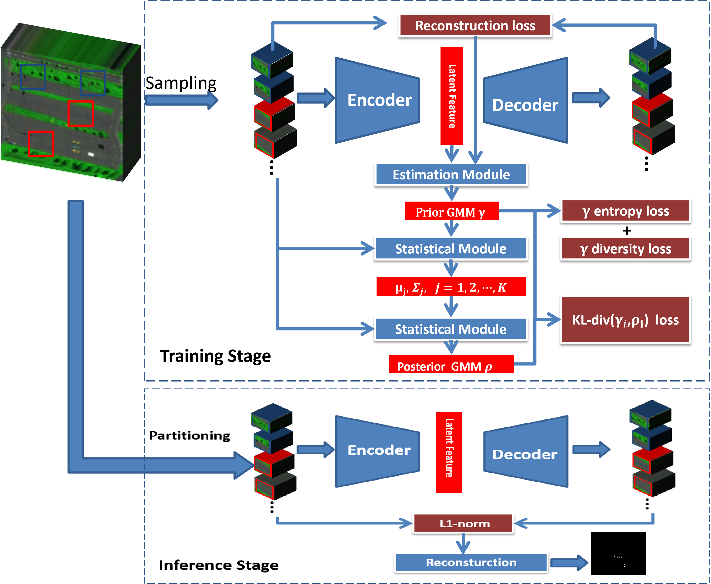

# DAGMM
A Novel Deep AutoEncoder based on Gaussian Mixture Model for Hyperspectral Anomaly Detection
The key to hyperspectral anomaly detection lies in background modeling. By measuring the fitness of the background model, the separation between the background and anomalies can be achieved. Recently, due to the extremely strong nonlinear representation ability of deep learning, the background modeling method based on Autoencoders has gradually gained more popularity in hyperspectral anomaly detection. However, due to the diversity of scenes in hyperspectral images, there are often multiple land cover and a large number of mixed pixels. Therefore, unified background modeling often does not fit the actual situation. Therefore, in this paper, a novel Deep Autoencoder based on Gaussian Mixture Model for Hyperspectral Anomaly Detection, namely DAGMM, is proposed. Firstly, the AutoEncoder is employed to reconstruct each patch in the hyperspectral image. Then, an estimation module is used to predict the component of each patch based on the latent feature and its reconstruction error, and the KL divergence is calculated with the posterior probability of clustering using the Gaussian Mixture Model. Finally, through continuous iteration, minimize this KL divergence to achieve a balance between the prior prediction and the posterior probability, and complete the goals of clustering and reconstruction to finish the training steps. In the inference stage, we use the reconstruction error as an indicator to determine anomaly targets. Experiments on the public datasets of hyperspectral anomaly detection show that our DAGMM algorithm has significant advantages over many SOTA algorithms and can also complete the clustering task, which proves the effectiveness of the algorithm. The code can be available at http://github.com/l7170/DAGMM.

The paper has been submitted to IEEE TGRS. The code will be made public after the first review of the paper.
